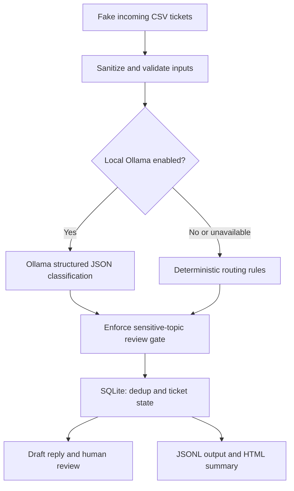

# AI Support Triage Automation — Portfolio Demonstrator

A small, **working**, privacy-conscious support-operations automation demonstration built with Python's standard library and optionally a **local Ollama** language model. No paid API, cloud service or Python package installation is required.

> **Scope and provenance:** This is an independently prepared portfolio **demonstration**, using entirely synthetic tickets. It is **not** a deployed enterprise system and has not been used by real customers or businesses. AI assistance was used in its development. It demonstrates an approach rather than claiming commercial experience.

## What problem it demonstrates

A small e-commerce customer support team receives incoming requests in different formats. Classifying issues, recognizing cancellation/refund/security-sensitive messages, preparing responses and tracking the same tickets repeatedly can consume unnecessary manual effort.

This demo turns a sample CSV inbox into:

- Validated category and priority decisions (billing, technical, shipping, cancellation, other)
- **Human review gates** for billing, cancellation and sensitive keywords
- Suggested reply **drafts only** — no automatic customer messaging
- Persistent SQLite state and idempotency by ticket ID and content checksum
- Optional Ollama JSON-schema classification, with a tested deterministic fallback if the model is unavailable
- JSONL export plus a simple HTML dashboard
- Fully offline demo mode and automated tests

## Architecture



## Run the demo

Requirements: **Python 3.10+**. From the root of this repository:

```bash
python3 -m support_triage.cli run --input examples/tickets.csv --db runs/demo.sqlite3
python3 -m support_triage.cli report --db runs/demo.sqlite3 --format html --output runs/dashboard.html
python3 -m support_triage.cli export --db runs/demo.sqlite3 --output runs/decisions.jsonl
python3 -m support_triage.cli review DEMO-002 --db runs/demo.sqlite3
python3 -m unittest discover -s tests -v
```

Open `runs/dashboard.html` locally. Run the import twice to see `unchanged_skipped` increase and `total` remain stable.

### Optional AI classification via local Ollama

Only after you have Ollama running on **the same machine** and have pulled a compatible chat model:

```bash
python3 -m support_triage.cli run --engine ollama --model gemma3:12b --input examples/tickets.csv --db runs/ollama.sqlite3
```

This makes a local request to `http://127.0.0.1:11434/api/chat`. The model is asked for a strict JSON-schema response; invalid/unavailable responses fail over to local rules and are counted in `ollama_fallbacks`.

**No live Ollama inference was run when initially packaging the demo.** The deterministic workflow and its tests were executed locally. Do not claim an AI accuracy rate until measured on a reviewed dataset.

## Safety and limitations

- Demo only. Sample ticket data is fictional; don't import real customer records without a privacy and security review.
- All output responses are **drafts** requiring human approval; this program does not send email, alter orders, issue refunds or access payment systems.
- Model output is untrusted and checked against an allowlist. Tickets are provided as untrusted input, not instructions. There is no autonomous execution of model recommendations.
- Request data sent to local Ollama is limited to 500 subject characters + 3,000 message characters. It is **not automatically redacted**; use fictional data for demonstrations.
- The heuristic rule classifier is deliberately simple and English-oriented; it's not production-grade.
- An unavailable Ollama service falls back to the rule-based classifier. This preserves the workflow, but is not equivalent to AI analysis.
- SQLite is adequate for a local demonstration, not a distributed multi-worker queue.
- Production would require authenticated ingestion, rate-limiting, structured logs, RBAC, PII redaction, real integration tests, observability, and a human-reviewed deployment plan.

## Suggested interview walkthrough (2 minutes)

1. Explain the business pain: ticket triage, backlogs, sensitive requests, and manual routing.
2. Run the sample CSV and show the CLI outputs, review queue, and HTML dashboard.
3. Repeat the import to demonstrate idempotency without duplicate tickets.
4. Explain the `Ollama → JSON validation → safe fallback` architecture.
5. Explain what you would add for a real client: CRM helpdesk integration, permissions, redaction, and measurable quality gates.

## Repository contents

```text
support_triage/core.py       Classification and local Ollama adapter
support_triage/store.py      SQLite persistence and review state
support_triage/cli.py        CLI, export and dashboard
examples/tickets.csv         Synthetic data only
tests/test_triage.py         Automated unit and end-to-end tests
```